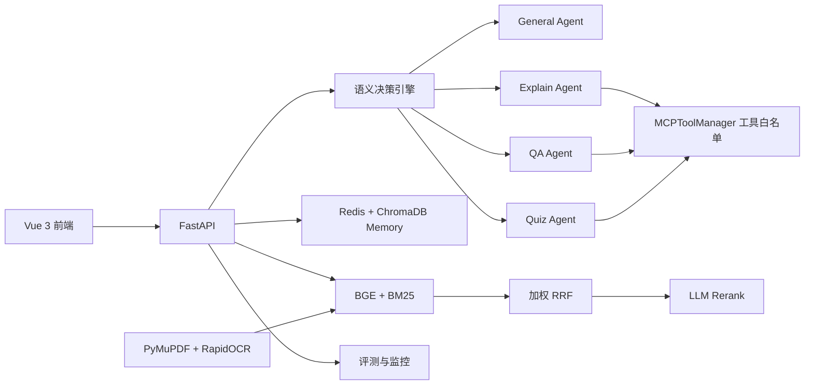

# ProgMind

ProgMind 是一个面向课程学习场景的多 Agent 智能学习助手。项目将意图识别、结构化角色路由、课程知识库 RAG、学习记忆、工具白名单、PDF/OCR 文档摄取、自动评测和运行监控整合为一套完整链路。

仓库中的部分环境变量、容器名和历史注释仍保留 `EchoMind` 前缀，以兼容已有部署；当前项目名称和前端包名均为 **ProgMind**。

## 核心能力

- **结构化多 Agent**：内置通用、讲解、答疑和练习四类 Agent，每个角色拥有独立的职责、输入输出契约、执行流程和升级条件。
- **语义决策与协作**：通过结构化决策判断使用单 Agent、并行协作或串行协作，不依赖简单关键词匹配；多 Agent 结果由 LLM 统一去重和整合。
- **安全降级**：专用 Agent 不可用时降级到 General Agent，而不是固定降级到讲解 Agent。
- **真实工具白名单**：模型只会看到当前角色获准使用的工具，服务端再次执行权限和参数校验。
- **混合 RAG**：使用 BGE 向量召回与 BM25 关键词召回，经加权 RRF 融合后再由 LLM rerank。
- **课程资料摄取**：支持 TXT、Markdown、JSON 和 PDF；原生 PDF 使用 PyMuPDF 提取文本，扫描页自动使用 RapidOCR。
- **学习记忆**：Redis 保存工作记忆，ChromaDB 保存情景记忆、用户画像和课程知识。
- **自动评测**：支持意图准确率、Macro-F1、多轮对话质量、回归检测和基线对比。
- **可观测性**：提供 Agent/工具统计、Prometheus 指标和运行监控接口。
- **Vue 前端**：包含对话、知识库、评测和监控页面，支持 SSE 流式回答。

## 系统架构



一次典型学习请求的执行顺序如下：

```text
读取 Memory → 语义决策 → 课程资料召回 → RRF 融合 → LLM 重排
→ 单/多 Agent 执行 → 答案综合 → 写回 Memory → 指标记录
```

## Agent 与工具权限

| Agent | 主要职责 | 可用工具 |
| --- | --- | --- |
| General Agent | 问候、复习概述、意图不明确请求和统一降级 | 无 |
| Explain Agent | 概念讲解、示例和理解检查 | `check_prerequisites` |
| QA Agent | 卡点诊断和渐进提示 | `build_hint_plan` |
| Quiz Agent | 题目检索、答案评分和学习结果记录 | `search_question_bank`、`grade_answer`、`record_learning_result` |

普通课程 RAG 和 Memory 属于请求预处理流程，不作为可由 Agent 重复调用的工具，从而避免双层管理和重复检索。

## 技术栈

| 层级 | 技术 |
| --- | --- |
| 后端 | Python、FastAPI、Pydantic、Uvicorn |
| LLM | Anthropic SDK，支持兼容 Anthropic 协议的服务 |
| 前端 | Vue 3、TypeScript、Vite、Element Plus |
| 检索 | BAAI/bge-small-zh-v1.5、BM25、加权 RRF、LLM rerank |
| 存储 | Redis、ChromaDB |
| 文档解析 | PyMuPDF、RapidOCR、ONNX Runtime |
| 监控 | Prometheus |
| 测试 | pytest / unittest |

## 目录结构

```text
ProgMind/
├─ agents/          # Agent 角色契约、执行与协作编排
├─ api/             # FastAPI 入口和 HTTP/SSE 接口
├─ core/            # 意图识别、语义决策和 Skill 加载
├─ evaluation/      # 默认评测集、质量评分和回归检测
├─ frontend/        # Vue 3 前端
├─ ingestion/       # PDF 检测、OCR、清洗和分页切片
├─ mcp/             # 工具管理器与混合知识库检索
├─ memory/          # Redis/ChromaDB 学习记忆
├─ monitor/         # 性能监控和告警
├─ skills/          # 可热加载的 Agent Skill 描述
├─ tools/           # 五个独立的学习工具及统一注册入口
├─ tests/           # 单元测试和链路测试
├─ .env.example     # 环境变量模板
├─ docker-compose.yml
└─ requirements.txt
```

## 环境要求

- Python 3.12（与 Docker 镜像保持一致）
- Node.js 18+ 与 npm
- Docker Desktop（推荐用于启动 Redis 和 ChromaDB）
- 可用的 Anthropic API Key，或兼容 Anthropic Messages API 的服务密钥
- 建议至少 4 GB 可用内存；首次初始化会下载 BGE 和 OCR 相关模型

## 本地开发启动

### 1. 克隆项目

```bash
git clone https://github.com/tsechiying99-sys/ProgMind.git
cd ProgMind
```

### 2. 创建 Python 虚拟环境

Windows PowerShell：

```powershell
python -m venv .venv
.\.venv\Scripts\Activate.ps1
python -m pip install --upgrade pip
pip install -r requirements.txt
```

Linux/macOS：

```bash
python3 -m venv .venv
source .venv/bin/activate
python -m pip install --upgrade pip
pip install -r requirements.txt
```

### 3. 准备环境变量

Windows PowerShell：

```powershell
Copy-Item .env.example .env
```

Linux/macOS：

```bash
cp .env.example .env
```

至少填写：

```env
ANTHROPIC_API_KEY=your_api_key
ANTHROPIC_MODEL=claude-3-5-sonnet-20241022
```

如使用兼容 Anthropic 协议的第三方服务，还需要设置：

```env
ANTHROPIC_BASE_URL=https://your-provider.example/anthropic
ANTHROPIC_MODEL=your-model-name
```

> 不要提交 `.env`。项目已经通过 `.gitignore` 排除该文件。

### 4. 启动 Redis 与 ChromaDB

```bash
docker compose up -d redis chromadb
```

使用 Docker Compose 默认 Redis 密码时，请将本地 `.env` 中的连接地址改为：

```env
REDIS_URL=redis://:echomind123@localhost:6379/0
CHROMA_HOST=localhost
CHROMA_PORT=8001
CHROMA_PERSIST_DIRECTORY=./data/chroma
```

### 5. 启动后端

```bash
python -m uvicorn api.main:app --host 0.0.0.0 --port 8000 --reload
```

启动成功后可访问：

- API：<http://localhost:8000>
- Swagger：<http://localhost:8000/docs>
- 健康检查：<http://localhost:8000/health>
- Prometheus 指标：<http://localhost:8000/metrics>

### 6. 启动前端

打开另一个终端：

```bash
cd frontend
npm install
npm run dev
```

访问 <http://localhost:5173>。Vite 会把 `/api/*` 请求代理到本地 `8000` 端口，并自动移除 `/api` 前缀。

## Docker 启动后端服务

```bash
docker compose up -d --build
```

该命令会启动后端、Redis、ChromaDB、Prometheus 和 Nginx：

- Nginx/API：<http://localhost>
- FastAPI 直连：<http://localhost:8000>
- ChromaDB：<http://localhost:8001>
- Prometheus：<http://localhost:9090>

当前 Compose 文件不负责构建 Vue 前端；前端开发请使用 `npm run dev`，生产环境可将 `npm run build` 的产物交给独立静态服务器或 CDN。

查看服务日志：

```bash
docker compose logs -f echomind
```

停止服务：

```bash
docker compose down
```

## 导入课程知识

知识库支持 `.txt`、`.md`、`.json` 和 `.pdf` 文件。PDF 会逐页判断是否存在可用原生文本，只有扫描页或低质量页面才进入 OCR，最终完成清洗、分页感知切片、BGE 向量化和 ChromaDB 入库。

```bash
curl -X POST http://localhost:8000/knowledge/upload \
  -F "file=@./course-material.pdf"
```

也可以直接批量提交文本：

```bash
curl -X POST http://localhost:8000/knowledge/add \
  -H "Content-Type: application/json" \
  -d '{"documents":[{"title":"Java 基础","content":"Java 是一种面向对象编程语言……"}]}'
```

查看知识库状态：

```bash
curl http://localhost:8000/knowledge/stats
```

## 调用示例

普通对话：

```bash
curl -X POST http://localhost:8000/chat \
  -H "Content-Type: application/json" \
  -d '{"message":"请用例子讲解 Java 多态","user_id":"demo-user"}'
```

复用响应中的 `conv_id` 可以继续同一轮学习对话：

```json
{
  "message": "再给我出一道练习题",
  "user_id": "demo-user",
  "conv_id": "previous-conversation-id"
}
```

单独验证增强检索：

```bash
curl -X POST "http://localhost:8000/search?query=Java%20多态&top_k=5"
```

运行默认评测：

```bash
curl -X POST http://localhost:8000/eval/run \
  -H "Content-Type: application/json" \
  -d '{}'
```

评测会返回意图识别指标、四维回答质量、整组通过率、回归项和改进建议。真实评测会调用配置的 LLM，因此耗时和费用与用例数量有关。

## 主要接口

| 方法 | 路径 | 说明 |
| --- | --- | --- |
| `GET` | `/health` | 服务状态与 Agent 统计 |
| `POST` | `/chat` | 普通学习对话 |
| `POST` | `/chat/stream` | SSE 流式学习对话 |
| `POST` | `/search` | RRF + LLM rerank 增强检索 |
| `POST` | `/knowledge/add` | 批量导入文本知识 |
| `POST` | `/knowledge/upload` | 上传 TXT、MD、JSON 或 PDF |
| `GET` | `/knowledge/stats` | 知识库片段统计 |
| `GET` | `/skills` | 当前 Skill 加载状态 |
| `POST` | `/skills/reload` | 热加载 Skills |
| `POST` | `/eval/run` | 执行默认或自定义评测 |
| `GET` | `/monitor` | Agent、工具和告警摘要 |
| `GET` | `/metrics` | Prometheus 指标 |

## 关键配置

| 环境变量 | 默认值 | 作用 |
| --- | --- | --- |
| `INTENT_MIN_CONFIDENCE` | `0.55` | 低置信度意图进入澄清路径 |
| `RAG_DECISION_THRESHOLD` | `0.55` | 是否启用课程知识检索的阈值 |
| `COLLABORATION_MIN_CONFIDENCE` | `0.70` | 启用多 Agent 协作的最低置信度 |
| `RAG_LLM_RERANK_ENABLED` | `true` | 是否在 RRF 后执行 LLM 重排 |
| `RAG_RERANK_MAX_CANDIDATES` | `10` | 发送给 LLM 的最大候选数 |
| `RAG_RERANK_CONTENT_CHARS` | `1000` | 每个重排候选的最大正文字符数 |
| `RAG_RERANK_TIMEOUT_S` | `30` | LLM 重排超时时间 |
| `KNOWLEDGE_MAX_UPLOAD_MB` | `30` | 单个上传文件大小限制 |
| `KNOWLEDGE_MAX_PDF_PAGES` | `200` | PDF 最大页数 |
| `KNOWLEDGE_CHUNK_SIZE` | `700` | 知识切片目标长度 |
| `KNOWLEDGE_CHUNK_OVERLAP` | `80` | 相邻切片重叠长度 |

完整配置请查看 [`.env.example`](.env.example)。LLM rerank 失败、超时或返回非法结构时，系统会自动保留 RRF 原始顺序，不会中断知识检索。

## 测试与构建

运行后端测试：

```bash
python -m pytest -q
```

检查 Python 模块：

```bash
python -m compileall -q agents api core ingestion mcp tools
```

检查并构建前端：

```bash
cd frontend
npm run typecheck
npm run build
```

测试覆盖 Agent 角色与白名单、决策引擎、多 Agent 答案综合、聊天 RAG、LLM rerank、PDF/OCR 摄取和评测默认数据集。

## 常见问题

### 后端启动时报 `未设置 ANTHROPIC_API_KEY`

确认根目录存在 `.env`，并且已经填写有效的 `ANTHROPIC_API_KEY`。仅复制模板但不替换占位值无法完成真实模型调用。

### Redis 报认证失败

Docker Compose 默认启用了密码。使用本地后端连接 Compose 中的 Redis 时，应配置：

```env
REDIS_URL=redis://:echomind123@localhost:6379/0
```

### 第一次启动较慢

BGE Embedding 和 OCR 推理组件可能需要初始化或下载模型。Docker 镜像会在构建阶段预下载 BGE 与 ChromaDB 降级模型；本地首次运行请预留时间和磁盘空间。

### 前端显示超时，但后端仍在运行评测

`/eval/run` 会执行多条真实模型请求，完整评测可能持续较长时间。可以直接通过 Swagger 或 API 客户端调用并提高客户端超时时间，也可以减少自定义评测用例数量。

### 如何降低检索延迟和费用

可以减小 `RAG_RERANK_MAX_CANDIDATES` 或 `RAG_RERANK_CONTENT_CHARS`；如需完全关闭 LLM 重排，将 `RAG_LLM_RERANK_ENABLED` 设为 `false`，系统将使用加权 RRF 排序。

## 安全提示

- 不要将 `.env`、API Key、Redis 密码或生产 JWT 密钥提交到仓库。
- 生产环境应限制 CORS、Swagger、`/metrics`、知识上传和评测接口的访问权限。
- 当前默认配置面向开发和作品展示；公网部署前应增加身份认证、上传隔离、限流和 HTTPS。

